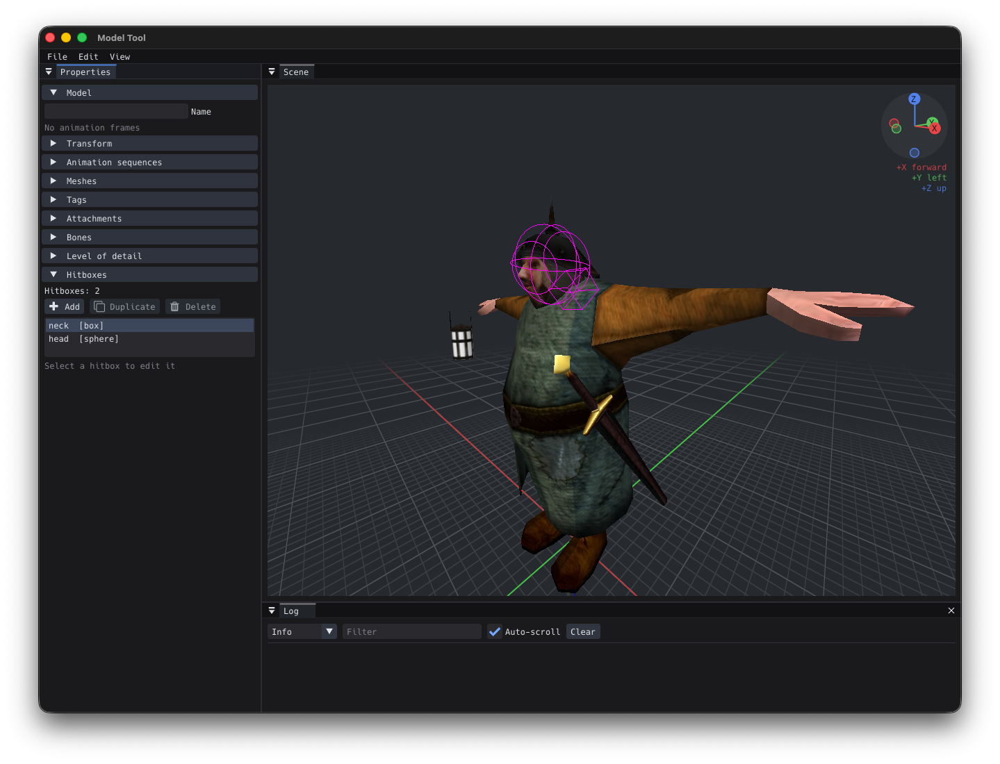

# ModelTool [](https://github.com/jackeri/ModelTool/actions/workflows/cmake.yml)
> Jere 'Jacker' S. 2021

ModelTool is a viewer and editor for game models, mainly for Wolfenstein: Enemy Territory and the model formats of
the [ET:Legacy](https://www.etlegacy.com) project. It loads models the way the game does (from a base folder and the
`.pk3` files in it), shows them with their textures and animations, does the usual model fixes, and converts between
the formats.

It comes as a desktop application (`ModelTool`) and a command line tool (`mt`) built on the same library.



## Features

### Formats

| Format | Read | Write | Notes |
|---|---|---|---|
| MD3 | yes | yes | Morph (vertex) animated models, levels of detail (`model_1.md3`, `model_2.md3`, ...), tags |
| MD3 tags only | | yes | Tag animation without surfaces |
| MDC | yes | | Compressed MD3 |
| MDM + MDX | yes | yes | ET skeletal mesh and animation |
| MDS | yes | yes | RtCW skeletal model |
| MD5 (`.md5mesh`, `.md5anim`) | yes | yes | |
| IQM | yes | | |
| MS3D (MilkShape 3D) | yes | | Mesh and animation |
| FBX, OBJ | yes | | Through ufbx |
| glTF, GLB | yes | | Through tinygltf |
| STL | | yes | Binary or text |
| `.aninc` | yes | yes | Animation sequences (ET animation scripts) |
| `.tag` | yes | yes | Tags file |
| `.hitboxes` | yes | yes | Hitboxes; old LegacyModelView `.htx` files are read too |
| `.skin` | yes | | Shaders per mesh, Quake 3 and ET style |
| `animation.cfg` | yes | | Quake 3 style player models |

Every binary loader checks the file against its size, so broken files give an error instead of a crash.

### Files like the game

- **Base folders**: add the game's mod folder (like `etmain`), and its loose files, `.pk3dir` folders and `.pk3`
  files act as one file system. Several base folders can be added.
- **Search order** in a base folder: loose files first, then `.pk3dir` folders, then `.pk3` files, later package
  names first (`pak1.pk3` over `pak0.pk3`).
- **Upper and lower case** in file names are ignored like the game does (can be turned off in the settings).
- **Textures** are found from the shader names of the meshes: the name as it is, or with an image extension added
  (`.tga`, `.jpg`, `.png`, ...), next to the model or in the base folders. Picmip and texture filtering can be set.

### Viewing

- Textured, lit model with wireframe, alpha and texture toggles
- Ground grid that reaches the edges of the view and fades out, with the X / Y / Z axes
- Overlays: bounding box, hitboxes, tags (with names), skeleton, vertex normals
- Orientation gizmo in the corner (+X forward, +Y left, +Z up); clicking an axis looks from that side
- Orbit, pan and zoom camera, frame the model (F)
- Animation playback: play / pause, speed, frame range, interpolation between frames, looping, animation sequences
- Levels of detail: the MD3 levels and dynamic level of detail with the collapse maps
- Sharp text and 3D view on HiDPI / Retina screens
- Screenshots from the command line (with or without the user interface)

### Editing

- Model: name, transform (location, rotation, scale), export frame range
- Meshes, tags (add, remove, rename, move to another bone), bones (rename, use as tag, torso weight), animation
  sequences (add, edit, remove)
- Edit menu: recalculate normals, calculate the level of detail collapse maps, optimize vertices, scale the bounding
  boxes, apply the transform, bake a pose into the bind pose, bake bone tags into tags, reorganize the armature to the
  ET player bones, check the armature
- **Gizmos**: select a tag or a hitbox and move (G) or rotate (R) it in the 3D view, scale (S) hitboxes; local or
  world axes, Ctrl snaps, Escape deselects. MD3 tags can be moved in every frame at once (keeping their animation)
- **Hitboxes**: boxes, spheres, cylinders and capsules on bones, with a list and an editor (name, bone, head
  modifier, shape, location, rotation, size), add / duplicate / delete
- Export to every writable format, one format at a time or "Export all" into a folder

### Player models and attachments

- Opening an `animation.cfg` loads a three part player model: `lower.md3` as the model, `upper.md3` on its
  `tag_torso` and `head.md3` on the upper's `tag_head`, with their levels of detail
- Skins (`lower_<name>.skin`, ...) can be switched, legs and torso sequences are picked separately (death sequences
  play on both)
- Any model can be attached to a tag or a bone of the model (or of another attached model) with the Attach button of
  the tag or bone; attached models follow it in every frame and have their own frames and sequences

### Application

- File picker for the base folders: the base folders are the root and the `.pk3` / `.pk3dir` contents look like
  normal folders; the source of every file is shown; fuzzy search over every file (`grunt hd` finds
  `models/players/grunt/head.md3`)
- Recent models, the last used folder, the window, the layout, the view options and the settings are kept between runs
- Settings: theme (Darker, Dark, Light), font size, vertical sync, case insensitive file names, scene background
- Log panel with level filter and search
- The Hack font and Font Awesome icons are built into the program

### Keyboard

| Key | Action |
|---|---|
| Ctrl+O | Open model (Cmd on macOS) |
| Ctrl+, | Settings |
| Ctrl+Q | Quit |
| Space | Play / pause |
| F | Frame the model |
| W / T / N / L | Wireframe / textures / interpolation / dynamic level of detail |
| Ctrl+B | Bounding box |
| Alt+O / Alt+T / Alt+S / Alt+N | Grid / tags / skeleton / normals |
| G / R / S | Move / rotate / scale gizmo |
| Escape | Deselect the tag or hitbox |
| Shift+Escape | Show / hide the log |

## Usage

On the first start the application asks for the base folder: the game's mod folder, like `etmain`. Models can then be
opened from the base folders (File > Open from base folders), or from anywhere on the disk (File > Open model).

Mouse in the 3D view: left drag orbits, right or middle drag pans, the wheel zooms.

### Command line options of the application

```
ModelTool [--base folder]... [--model path] [--animation path]... [--hitboxes file] [--frame n]
          [--skin name] [--attach tag=file]... [--sequence name]...
          [--view wireframe,notextures,alpha,nogrid,bounds,nohitboxes,tags,skeleton,normals,dynamiclod]
          [--export out.ext]... [--screenshot out.png [--ui]] [--size WxH] [--frames n]
```

For example a screenshot of an animated model, without opening a window:

```
ModelTool --base etmain --model models/players/temperate/body.mdm --animation animations/human/base/body.mdx \
          --frame 100 --view skeleton,tags --screenshot body.png
```

### Command line tool `mt`

```
mt [--base folder]... <command> [options]

  formats                        list the readable and writable formats
  info <model>                   meshes, bones, tags, hitboxes, animation sequences, bounds
                                 (animation.cfg: the player model's parts, skins and sequences)
  convert <model> <output>...    write the model, the format comes from the output extension
  list [folder]                  list the model files in the base folders and pk3 files

  --animation file, --hitboxes file, --frames first:last, --scale s, --normals smooth|flat,
  --optimize, --lod, --save-hitboxes file, --case-sensitive, --help, --version
```

```
mt --base etmain info models/mapobjects/tree/tree.md3
mt convert bob.md5mesh bob.md3 bob.mdm --animation bob.md5anim --frames 0:10 --scale 2
```

Exit codes: 0 ok, 1 failed, 2 invalid command line.

## Compile

Needs CMake 3.20 or newer and a C++17 compiler. The build works on Windows, macOS and Linux (OpenGL 4.1).

Fetch the submodules:

```
git submodule update --init
```

Build:

```
cmake -B build -S .
cmake --build build --config Release
```

- Tests: `ctest` in the build directory (GoogleTest, the fixtures are in `data/`)
- Application: `build/ModelTool` (`build/ModelTool.app` on macOS); on some unix platforms
  `LC_CTYPE=en_US.UTF-8 build/ModelTool` might be needed
- Command line tool: `build/mt`
- Packages: `cpack -G ZIP` in the build directory (DragNDrop on macOS, WIX on Windows and TGZ on Linux too)
- `-DNATIVE_DIALOG=ON` uses the system's file dialogs (nativefiledialog)

## Libraries

| Library | Version | Used for | License | In the source tree |
|---|---|---|---|---|
| [Dear ImGui](https://github.com/ocornut/imgui) | 1.91.3 (docking) | User interface | MIT | submodule `libs/imgui` |
| [GLFW](https://github.com/glfw/glfw) | 3.4 | Window, input, OpenGL context | zlib | submodule `libs/glfw` |
| [glad](https://github.com/Dav1dde/glad) | 2.0.8 (generated, GL 4.1 core) | OpenGL loader | WTFPL / CC0, Apache-2.0 (Khronos) | generated files `libs/glad` |
| [GLM](https://github.com/g-truc/glm) | 0.9.9.8 | Math | MIT | submodule `libs/glm` |
| [stb](https://github.com/nothings/stb) | stb_image 2.30, stb_image_write 1.16 | Loading textures, writing screenshots | MIT / public domain | submodule `libs/stb` |
| [spdlog](https://github.com/gabime/spdlog) | 1.14.1 | Logging | MIT | submodule `libs/spdlog` |
| [tinygltf](https://github.com/syoyo/tinygltf) | 2.9 | glTF and GLB import | MIT | submodule `libs/tinygltf` |
| [ufbx](https://github.com/ufbx/ufbx) | 0.23.1 | FBX and OBJ import | MIT / public domain | vendored `libs/ufbx` |
| [zlib](https://github.com/madler/zlib) + minizip | 1.3.2 | Reading `.pk3` (zip) files | zlib | submodule `libs/zlib` |
| [imgui-filebrowser](https://github.com/jackeri/imgui-filebrowser) | fork of [AirGuanZ/imgui-filebrowser](https://github.com/AirGuanZ/imgui-filebrowser) | File dialogs for the disk | MIT | submodule `libs/imgui-filebrowser` |
| [ImGuizmo](https://github.com/CedricGuillemet/ImGuizmo) | commit df1c301 (2025-12-03) | Move / rotate / scale gizmos | MIT | vendored `libs/imguizmo` |
| [GoogleTest](https://github.com/google/googletest) | 1.15.2 | Tests (not in the program) | BSD-3-Clause | submodule `libs/googletest` |
| [nativefiledialog](https://github.com/mlabbe/nativefiledialog) | 1.1.6 | System file dialogs, only with `-DNATIVE_DIALOG=ON` | zlib | submodule `libs/nativefiledialog` |

Fonts and icons built into the application:

| Font | Used for | License |
|---|---|---|
| [Hack](https://github.com/source-foundry/Hack) | User interface text | MIT, Bitstream Vera |
| [Font Awesome 4.7](https://fontawesome.com/v4/) | Icons | SIL OFL 1.1 |
| [IconFontCppHeaders](https://github.com/juliettef/IconFontCppHeaders) (`src/app/icons_font_awesome.h`) | Icon names | zlib |

# License

ModelTool is licensed under the MIT License, see [LICENSE](./LICENSE.txt) for more information.
